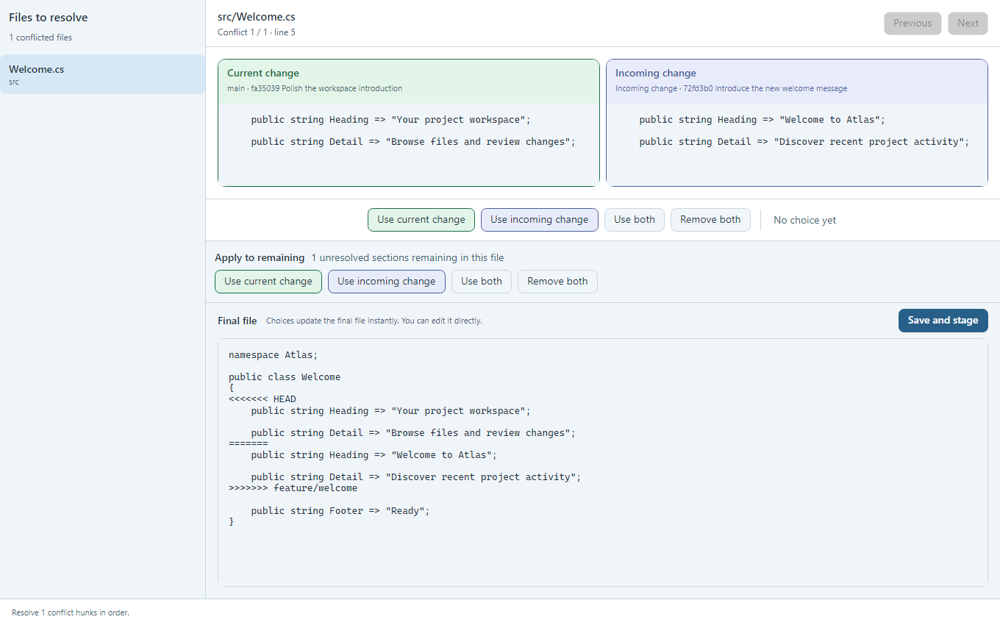

# Bough

[한국어](README.md) | **English**

Bough is a desktop Git client for reviewing local changes, browsing commit history, and resolving merge conflicts. Its conflict editor shows where both sides came from and lets you preview how your choices affect the final file.

## Download and install

Get the stable release for your operating system from [GitHub Releases](https://github.com/EomTaeWook/Bough/releases). Install Git separately. The release includes the .NET runtime.

Latest stable release **v1.0.12** · [Windows x64](https://github.com/EomTaeWook/Bough/releases/download/v1.0.12/Bough-v1.0.12-win-x64.exe) · [Mac Apple Silicon](https://github.com/EomTaeWook/Bough/releases/download/v1.0.12/Bough-v1.0.12-osx-arm64.app.zip) · [Mac Intel](https://github.com/EomTaeWook/Bough/releases/download/v1.0.12/Bough-v1.0.12-osx-x64.app.zip) · [Release notes](https://github.com/EomTaeWook/Bough/releases/tag/v1.0.12)

| Operating system | How to run |
| --- | --- |
| Windows x64 | Download and run the `win-x64.exe` file. |
| macOS Apple Silicon | Extract `osx-arm64.app.zip`, move `Bough.app` to an Applications folder you can write to, and open it. |
| macOS Intel | Extract `osx-x64.app.zip` and follow the same steps. |

Mac releases target macOS 14 or later. They are not signed with Developer ID or notarized by Apple, so macOS may block them from opening.

## Get started

1. If Bough cannot find Git, choose its executable under **Settings → Git**. Change the language and theme under **Settings → General**.
2. At the top, select **+ → Open repository** and choose a local repository folder. To clone a repository, select **+ → Clone**, enter a remote URL or local source path, and choose a new destination or an empty folder.
3. Open **Local Changes** in the left sidebar. Review the files and diffs, stage the changes you want, and enter a commit message. For tracked plain-text files, you can stage or unstage selected lines in the diff.
4. Open **History** to browse the commit graph and inspect changes. Right-click a changed file to view its commits and renames. To switch repositories, click the repository name at the top.

## Resolve conflicts



If you closed the conflict window, reopen it from the conflicted file list in **Local Changes**.

- **Resolve one section at a time:** Compare the current and incoming changes, then choose a result for each section. Review or edit the final text before selecting **Save and Stage**.
- **Apply a batch choice:** Apply one choice to the remaining sections across all conflicted files, then save and stage them immediately. Batch actions keep existing choices and skip manual edits that cannot be separated from those choices.
- **Check a failure:** If Bough saved or deleted the working file but could not stage it, the message distinguishes those outcomes. After checking the cause, press **F5** to reread the current file state.
- **Finish the operation:** Once all conflicts are resolved and staged, commit the merge or select **Continue** for a rebase or revert.

## Remotes and references

- Use **Fetch**, **Pull**, and **Push** at the top. Open the arrow menus to choose a different target or Pull strategy. If an operation fails, its popup shows the details.
- Set the default Pull strategy and scope, and enable automatic remote checks under **Settings → General**. Remote checks report incoming commits. Run Pull to update your working files.
- Open **Accounts and authentication** in Settings to see URLs and authentication for each remote. Bough shows separate fetch and push URLs when they differ. Expand **Remote URL details** to inspect a separate push URL setting or a URL rewrite.
- Manage branches, tags, and stashes under **Git references** in the sidebar. To push a tag on its own, right-click it and choose the remote. To work inside a submodule, right-click it and choose **Open repository**.

## Application updates

Bough checks for a stable update once on startup. To check again, select **Settings → Application update → Check for updates**. Downloads and restarts require your action. Download progress appears in the lower left.

## Screenshots

These screenshots show example repositories. Details may differ by version or settings.

[Local changes](Docs/images/local-changes.png) · [History](Docs/images/history.png) · [File history](Docs/images/file-history.png) · [Settings](Docs/images/settings.png)

## Run from source

Install the .NET 10 SDK and Git, then run this from the repository root:

```sh
dotnet run --project Bough.App/Bough.App.csproj
```

## License

[Bough Source License 1.0](LICENSE) allows free personal, educational, and internal business use and modification. You may redistribute it without charge if you retain the license and copyright notice. Selling Bough or a substantially Bough-based Git client, including a renamed copy, is restricted. Third-party components remain under their own licenses.
