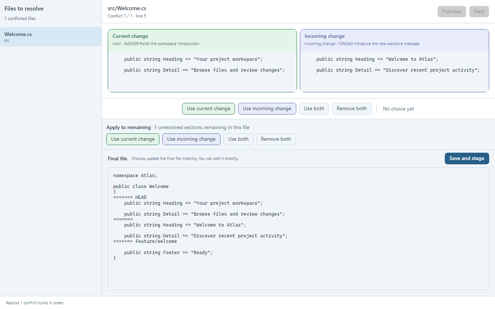

# Bough

**한국어** | [English](README.en.md)

Bough는 로컬 변경과 커밋 이력을 살펴보고 병합 충돌을 해결할 수 있는 데스크톱 Git 클라이언트입니다. 충돌 해결 창에서 양쪽 변경이 어디에서 왔는지 비교하고, 선택한 내용이 최종 파일에 어떻게 반영되는지 확인할 수 있습니다.

## 다운로드 및 설치

[GitHub Releases](https://github.com/EomTaeWook/Bough/releases)에서 운영체제에 맞는 정식 배포 파일을 받으세요. Git은 별도로 설치해야 하며, .NET 런타임은 배포 파일에 포함되어 있습니다.

최신 정식 릴리스 **v1.0.12** · [Windows x64](https://github.com/EomTaeWook/Bough/releases/download/v1.0.12/Bough-v1.0.12-win-x64.exe) · [Mac Apple Silicon](https://github.com/EomTaeWook/Bough/releases/download/v1.0.12/Bough-v1.0.12-osx-arm64.app.zip) · [Mac Intel](https://github.com/EomTaeWook/Bough/releases/download/v1.0.12/Bough-v1.0.12-osx-x64.app.zip) · [릴리스 정보](https://github.com/EomTaeWook/Bough/releases/tag/v1.0.12)

| 운영체제 | 실행 방법 |
| --- | --- |
| Windows x64 | `win-x64.exe` 파일을 내려받아 실행합니다. |
| macOS Apple Silicon | `osx-arm64.app.zip` 압축을 풀고 `Bough.app`을 쓰기 가능한 응용 프로그램 폴더로 옮겨 실행합니다. |
| macOS Intel | `osx-x64.app.zip` 압축을 풀고 같은 방법으로 실행합니다. |

Mac 배포 파일은 macOS 14 이상을 대상으로 합니다. Developer ID 서명과 Apple 공증이 없어 macOS 보안 정책에 따라 실행이 차단될 수 있습니다.

## 처음 사용하기

1. Bough가 Git을 찾지 못하면 **설정 → Git**에서 실행 파일 경로를 지정합니다. **설정 → 일반**에서 언어와 테마를 바꿀 수 있습니다.
2. 상단 **+ → 저장소 열기**에서 로컬 저장소 폴더를 고릅니다. 새로 복제하려면 **+ → 복제**에서 원격 URL 또는 로컬 원본 경로를 입력하고, 새 경로나 빈 폴더를 대상으로 지정합니다.
3. 왼쪽 **로컬 변경**에서 파일과 diff를 확인하고, 커밋에 포함할 변경을 스테이징한 뒤 메시지를 입력해 커밋합니다. 추적 중인 일반 텍스트 파일은 diff에서 변경 줄을 골라 부분 스테이징하거나 해제할 수 있습니다.
4. 왼쪽 **히스토리**에서 커밋 그래프와 변경 내용을 봅니다. 변경 파일을 우클릭하면 파일별 커밋과 이름 변경 이력도 살펴볼 수 있습니다. 다른 저장소로 바꾸려면 상단의 저장소 이름을 누릅니다.

## 충돌 해결



충돌 해결 창을 닫았으면 **로컬 변경**의 충돌 파일 목록에서 다시 열 수 있습니다.

- **구간별로 해결:** 현재 변경과 들어오는 변경을 비교해 구간마다 결과를 고릅니다. 최종 본문을 확인하거나 직접 편집한 뒤 **저장하고 스테이징**을 누릅니다.
- **일괄 적용:** 한 가지 선택을 모든 충돌 파일의 남은 구간에 적용하고 곧바로 저장·스테이징합니다. 이미 고른 구간은 유지하고, 구간 선택과 분리할 수 없는 수동 편집 파일은 제외합니다.
- **실패 후 확인:** 작업 파일을 저장하거나 삭제한 뒤 스테이징에 실패하면 안내에서 두 결과를 구분해 보여 줍니다. 원인을 확인한 뒤 현재 파일 상태를 다시 읽으려면 **F5**를 누릅니다.
- **작업 마무리:** 파일을 모두 해결하고 스테이징한 뒤, 병합 커밋이나 리베이스·Revert의 **계속**을 직접 실행합니다.

## 원격 작업과 참조

- 상단의 **Fetch**, **Pull**, **Push**를 사용합니다. 다른 대상이나 Pull 방식을 고르려면 각 버튼의 화살표 메뉴를 엽니다. 오류의 상세 내용은 해당 작업 팝업에서 확인할 수 있습니다.
- **설정 → 일반**에서 기본 Pull 방식과 범위를 고르고 원격 변경 자동 확인을 켤 수 있습니다. 자동 확인은 받을 커밋을 알려 주며, 작업 파일을 바꾸려면 Pull을 직접 실행합니다.
- 설정의 **계정 및 인증**에서 원격별 주소와 인증 계정을 확인합니다. 가져오기와 푸시 주소가 다르면 각각 표시합니다. 별도 푸시 주소나 URL 재작성 정보가 있으면 **원격 주소 상세**를 펼쳐 확인할 수 있습니다.
- 왼쪽 **Git 참조**에서 브랜치, 태그, Stash를 관리합니다. 태그만 보내려면 태그를 우클릭해 보낼 원격을 고릅니다. 서브모듈은 해당 항목을 우클릭해 **저장소 열기**를 선택한 뒤 그 저장소에서 작업합니다.

## 앱 업데이트

Bough는 시작할 때 정식 업데이트를 한 번 확인합니다. 다시 확인하려면 **설정 → 앱 업데이트 → 업데이트 확인**을 사용하세요. 다운로드와 재시작은 사용자가 요청할 때 진행합니다. 다운로드 진행은 왼쪽 하단에 표시합니다.

## 화면 예시

아래는 예시 저장소의 화면입니다. 버전이나 설정에 따라 실제 화면의 세부 배치는 다를 수 있습니다.

[로컬 변경](Docs/images/local-changes.png) · [히스토리](Docs/images/history.png) · [파일 히스토리](Docs/images/file-history.png) · [설정](Docs/images/settings.png)

## 소스에서 실행

.NET 10 SDK와 Git을 설치한 뒤 저장소 루트에서 실행합니다.

```sh
dotnet run --project Bough.App/Bough.App.csproj
```

## 라이선스

Bough는 [Bough Source License 1.0](LICENSE)에 따라 개인·교육·회사 내부 업무에서 무료로 사용하고 수정할 수 있습니다. 라이선스와 저작권 고지를 유지하면 무료로 재배포할 수 있지만, Bough 자체나 Bough를 바탕으로 만든 Git 클라이언트의 복제·개명본을 판매하는 것은 제한합니다. 제3자 구성요소에는 각자의 라이선스가 적용됩니다.
