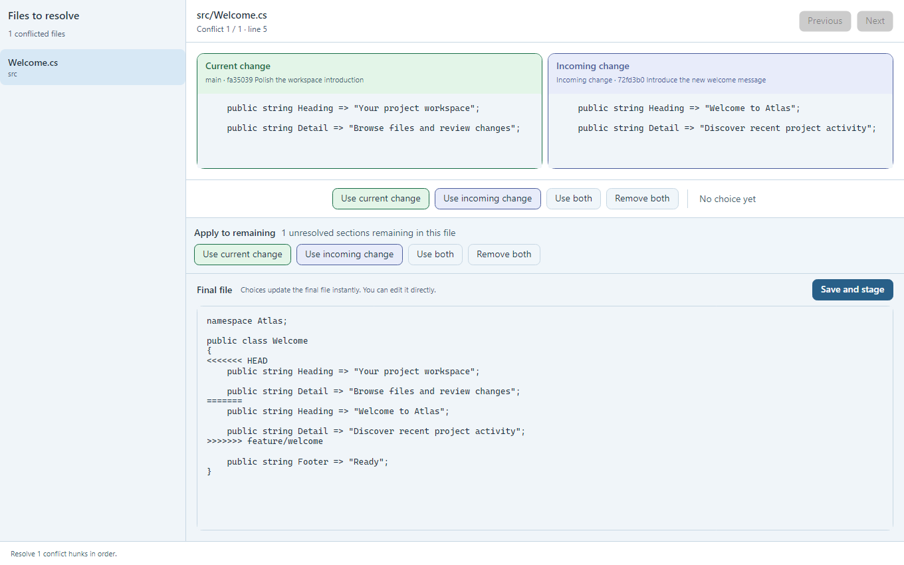
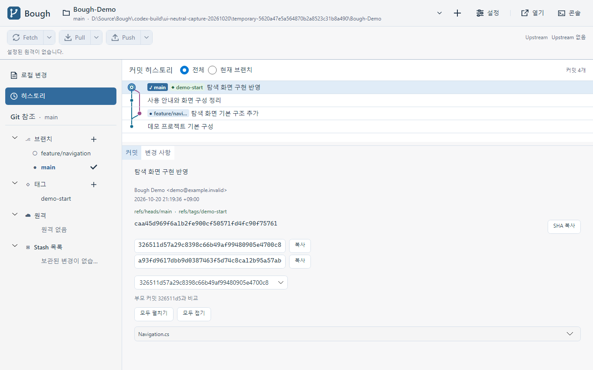
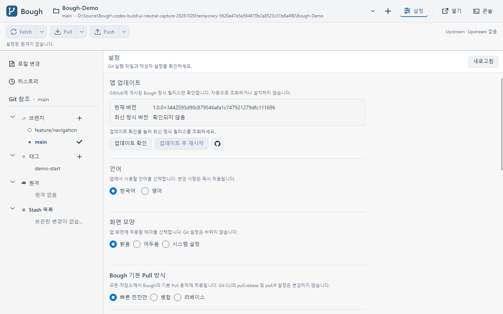
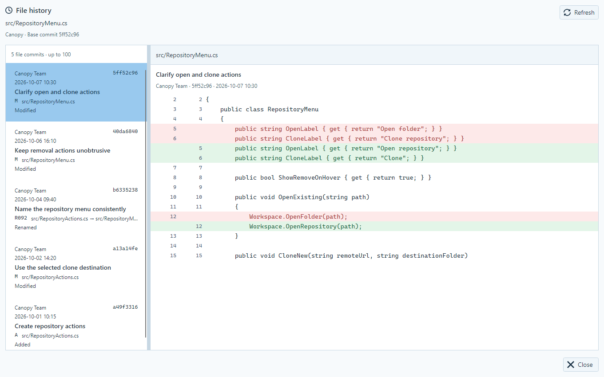
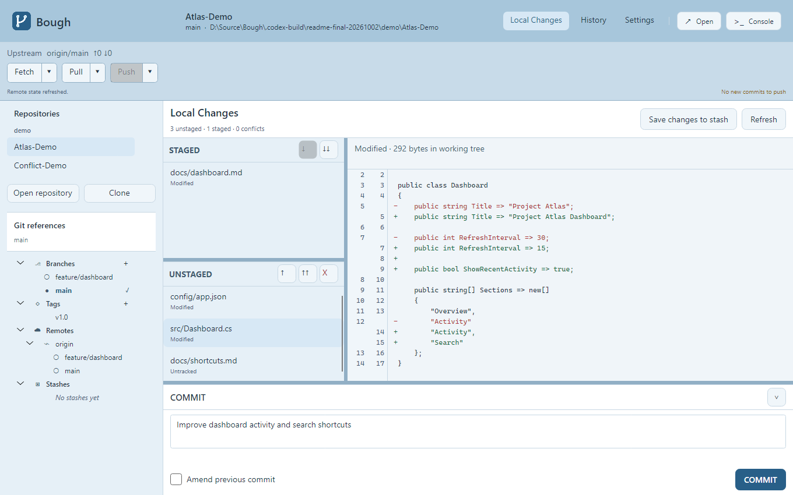

# Bough

**한국어** | [English](README.en.md)

**Bough는 병합 충돌을 더 명확하게 이해하고 해결하기 위한 Git GUI입니다.**

일상적인 Git 작업은 가볍고 빠르게 처리하고, 병합 충돌에서는 변경의 맥락과 선택 결과를 쉽게 파악할 수 있는 경험을 지향합니다.

## 다운로드

정식 패치 버전 **v1.0.4**를 제공합니다. [현재 기능과 상태](Docs/CurrentStatus.md) · [릴리스 기록](Docs/Releases.md)

[Bough v1.0.4 Windows x64 다운로드](https://github.com/EomTaeWook/Bough/releases/download/v1.0.4/Bough-v1.0.4-win-x64.exe) · [릴리스 정보](https://github.com/EomTaeWook/Bough/releases/tag/v1.0.4)

다운로드한 단일 `.exe` 파일을 실행하세요. 압축 해제나 .NET 설치는 필요 없지만 Git은 설치돼 있어야 합니다. 현재 배포 대상은 Windows x64입니다. macOS 실행은 아직 확인하지 않았습니다.

## 화면 미리보기

히스토리·설정 이미지는 v1.0.3에 포함된 중립 배경과 사이드바 탐색을 개발 빌드에서 촬영한 화면입니다. 설정에 표시된 개발 빌드 버전·커밋 정보는 정식 배포본과 다릅니다.

### 충돌 해결



실제 텍스트 병합 충돌을 재현한 화면입니다. 양쪽 변경의 출처를 비교하고 구간별로 선택하거나 최종 파일을 직접 편집할 수 있습니다. 최신 일괄 처리는 모든 충돌 파일의 남은 구간을 적용·저장·스테이징하며 이미 선택한 구간을 보존합니다. 스크린샷은 일괄 처리 변경 전 화면입니다.

### 히스토리



왼쪽 사이드바에서 History로 전환하고 브랜치 그래프·참조 배지와 선택한 병합 커밋의 상세 내용을 함께 볼 수 있습니다.

### 설정과 앱 업데이트



앱 업데이트 확인·언어·화면 모양·기본 Pull 방식을 한 화면에서 설정합니다. 원격을 등록하지 않은 데모여서 상단 원격 버튼은 비활성 상태이며, 촬영 중 업데이트 조회·다운로드는 실행하지 않았습니다.

### 파일 히스토리



변경 파일을 우클릭해 히스토리를 열면 전용 창에서 파일별 커밋과 당시 변경 내용을 나란히 볼 수 있습니다. 이름 변경을 따라가며 목록에서 커밋을 선택합니다.

### 로컬 변경



스테이징된 변경과 작업 파일을 구분하고 이전·현재 줄 번호가 있는 diff를 읽을 수 있습니다. 하단 커밋 영역에서 메시지를 작성하고 커밋을 준비합니다.

모든 이미지는 데모 저장소를 사용한 실제 앱 콘텐츠이며 운영체제 제목 표시줄은 포함하지 않았습니다. 히스토리·설정은 최신 소스의 밝은 테마·한국어 UI입니다. 충돌 해결·파일 히스토리·로컬 변경 이미지는 이전 영어 UI의 기능 예시로, 현재 소스와 색상·배치가 다를 수 있습니다.

## 왜 Bough인가요?

기존 Git GUI의 충돌 해결 화면에서는 다음과 같은 불편함이 있습니다.

- 충돌한 양쪽 변경이 어디에서 왔는지 직관적으로 알기 어렵습니다.
- 어떤 변경을 선택해야 할지 판단하는 데 필요한 맥락이 부족합니다.
- 선택한 내용이 최종 파일에 어떻게 반영되는지 즉시 확인하기 어렵습니다.
- 여러 저장소가 상단 탭에 쌓이는 방식은 현재 위치를 파악하고 저장소를 전환하기 불편합니다.

Bough는 충돌한 변경의 출처를 분명히 표시하고, 사용자가 선택한 결과를 최종 파일 미리보기에서 바로 확인할 수 있도록 설계합니다.

## 핵심 경험

- **명확한 변경 출처**: 브랜치, 커밋 등 각 변경이 만들어진 배경을 구분해 표시합니다.
- **읽기 쉬운 충돌 비교**: 충돌 구간과 주변 코드를 함께 보여 주어 판단에 필요한 맥락을 제공합니다.
- **즉각적인 결과 미리보기**: 선택한 변경이 최종 파일에 반영되는 모습을 실시간으로 확인합니다.
- **충돌 해결과 일괄 저장**: 구간별 결과를 편집·저장하거나 기존 선택을 보존해 남은 구간을 한 번에 적용·저장·스테이징합니다.
- **명확한 저장소 탐색**: 상단 탭에 의존하지 않고 현재 저장소와 작업 맥락을 쉽게 파악하고 전환할 수 있도록 합니다.

## 주요 기능

- **저장소 열기·복제**: 기존 로컬 저장소를 열거나 원격 URL·로컬 경로에서 새 경로 또는 빈 폴더로 복제해 목록에 등록
- **로컬 변경**: 변경 파일과 줄 번호가 있는 diff 확인, 스테이징·해제, 커밋, 변경 폐기·추적 중지·무시
- **히스토리와 참조**: 커밋 그래프와 파일 변경·파일별 이력 탐색, 선택 커밋 취소(Revert), 브랜치 생성·전환·삭제·이름 변경, 태그 생성·삭제·이름 변경
- **원격과 임시 보관**: Fetch·Pull·Push, 기본 Pull 방식 설정과 일회성 방식 선택, Stash 저장·적용·삭제
- **원격 자동 확인**: 설정에서 켜기·확인 주기를 정하고 현재 저장소의 받을 새 커밋 수를 표시. Pull은 직접 실행
- **서브모듈 저장소 열기**: 참조 트리에서 하위 저장소를 열고 해당 저장소의 Fetch·Pull·Push 사용
- **충돌 해결**: 병합·리베이스·Revert의 양쪽 변경 확인, 구간별 선택·직접 편집·파일별 저장과 모든 충돌 파일의 남은 구간 일괄 적용·저장·스테이징
- **앱 업데이트**: 설정에서 공식 정식 릴리스 확인, 다운로드 진행·취소와 정상 종료 후 단일 실행 파일 교체·재시작. 베타·사전 릴리스는 제외

중립 배경·히스토리와 참조 표현·진행 표시를 정리하고 Commit/Amend 대상 고정·Stash 완료 순서·종료 보호·후속 오류 처리를 보완한 v1.0.3을 배포했습니다. 최신 소스와 배포 파일에 포함된 변경은 [구현 현황](Docs/CurrentStatus.md)에 구분합니다.

앱 업데이트와 원격 자동 확인·서브모듈 저장소 열기, 업데이트 진행 막대의 좌하단 표시와 설정의 GitHub 릴리스 아이콘 버튼을 정식 배포에 포함합니다. 현재 소스는 좌하단에 상태 요약·진행만 표시하고 Fetch/Pull/Push 상세는 해당 작업 팝업에서 확인하도록 정리했습니다. 이 표시 정리는 v1.0.3 배포에 포함했습니다.

앱 내부 업데이트 후보는 공식 정식 릴리스만 사용합니다. 실제 업데이트 다운로드·교체·복원 전체 흐름과 최신 코드의 실행 확인은 완료하지 않았습니다.

확장 화면과 작업 흐름은 [Design 기획 문서](Design/README.md)에 정리했습니다.

## 기술 방향

- **언어**: C# / .NET
- **현재 배포 플랫폼**: Windows x64
- **UI**: Avalonia

기본 Git 기능을 제공하는 정식 버전을 배포합니다. 현재 기능과 확인되지 않은 동작은 [구현 현황](Docs/CurrentStatus.md)에 구분해 기록합니다. 개발 문서와 기획 문서는 각각 [Docs](Docs/README.md), [Design](Design/README.md)에서 볼 수 있습니다.

Bough는 Eidolon 같은 데스크톱 응용프로그램의 아키텍처 기준 사례입니다. 다른 앱에서 사용할 책임·작업 수명과 프로젝트별 매핑은 [응용프로그램 아키텍처](Docs/DesktopApplicationArchitecture.md)에 정리했습니다.

## 실행

### 배포 파일 실행

1. Git을 설치합니다. Git을 찾지 못하면 Bough의 **설정 → Git 실행 파일**에서 `git.exe` 경로를 지정합니다.
2. 위 다운로드 링크의 Windows x64 `.exe`를 원하는 폴더에 저장하고 실행합니다. 압축 해제, 별도 .NET 설치, DLL·데이터·설정 파일 복사는 필요 없습니다.
3. 상단 **+ → 저장소 열기**에서 기존 저장소 폴더를 선택하거나 **+ → 복제**에서 원격 URL·로컬 경로와 목적지 폴더를 지정합니다. 복제 목적지는 새 경로나 빈 폴더를 사용할 수 있습니다.
4. 상단의 현재 저장소를 눌러 최근 저장소로 전환합니다. **로컬 변경**에서 파일과 diff를 확인하고 스테이징한 뒤 커밋합니다. **히스토리**에서 과거 커밋을 살펴볼 수 있습니다.
5. **설정 → 언어**에서 한국어·영어를 선택합니다. 기본값은 한국어이며 변경 즉시 화면에 적용되고 다음 실행에도 유지됩니다.

사용자 설정과 최근 저장소 목록은 Windows의 `%LocalAppData%\Bough`에 저장합니다. 앱을 업데이트할 때 새 실행 파일로 바꿔도 이 설정은 유지됩니다.

### 소스에서 실행

개발 실행에는 .NET 10 SDK와 Git이 필요합니다. 저장소 루트에서 다음 명령을 실행합니다. macOS 배포 파일은 없으며 소스 실행도 아직 확인하지 않았습니다.

```powershell
dotnet run --project Bough.App/Bough.App.csproj
```

### 저장소 작업

복제가 완료되면 저장소를 최근 목록에 등록하고 엽니다. 목록의 제거 버튼은 마우스를 올리거나 키보드 포커스를 둘 때 표시됩니다. 충돌을 개별 처리할 때는 구간별로 선택하고 최종 파일을 확인하거나 편집한 뒤 **저장하고 스테이징**을 누릅니다. **일괄 적용**은 모든 충돌 파일의 미선택 구간을 같은 방식으로 적용하고 바로 저장·스테이징합니다. 기존 선택은 보존하고 분리할 수 없는 수동 편집 파일은 이유를 표시해 제외합니다. 병합 커밋·Rebase·Revert 계속은 직접 실행합니다. 현재 텍스트 충돌은 UTF-8 파일을 대상으로 합니다.

복제에 실패하면 Git 진단에서 식별한 인증·저장소 접근·연결·저장공간·파일 쓰기 등의 원인을 표시합니다. 목적지 상태는 별도로 안내하며, 빈 폴더라면 실패 원인을 해결한 뒤 같은 경로로 다시 시도할 수 있습니다. 실패 원인을 식별하지 못한 경우에는 일반 실패 문구와 종료 코드를 표시합니다.

왼쪽 사이드바의 **히스토리**를 누르면 모든 로컬·원격 참조의 커밋을 브랜치 그래프로 볼 수 있습니다. 커밋을 선택하면 작성자, 날짜, 메시지와 변경 파일이 상세 패널에 표시됩니다. 처음 200개를 표시하며 목록 아래로 스크롤하면 이전 기록을 이어서 불러옵니다. 커밋을 선택하거나 내용을 살펴보는 것만으로는 저장소가 변경되지 않습니다.

커밋을 우클릭해 **이 커밋 되돌리기…**를 선택하면 대상 변경을 취소하는 새 커밋을 현재 로컬 브랜치에 만듭니다. 저장소·HEAD·대상을 확인하고, 병합 커밋은 기준 부모를 직접 선택합니다. 작업 트리와 인덱스를 먼저 정리해야 하며 다른 Git 작업이 진행 중이면 시작하지 않습니다. 충돌이 생기면 해결·저장·스테이징한 뒤 진행 안내의 **계속**을 누릅니다. **중단**은 시작 전 상태로 돌아가며 충돌 해결 내용이나 작업 중 편집한 파일을 잃을 수 있으므로 먼저 확인합니다. Git 변경 성공 후 조회 오류는 새로 고침으로 처리합니다.

왼쪽 **Git 참조**에서 브랜치를 우클릭하면 로컬·원격 브랜치를 삭제할 수 있습니다. 삭제 전에 대상을 확인하며, 현재 체크아웃된 브랜치와 원격의 기본 브랜치는 삭제할 수 없습니다. 로컬 브랜치는 병합되지 않은 커밋이 있으면 삭제하지 않습니다. 원격 브랜치 삭제는 서버와 다른 사용자에게도 영향을 줍니다.

태그 우클릭의 **태그 삭제**를 누르면 한 창에서 로컬·원격 삭제 대상을 선택합니다. 기본값은 로컬이며, 원격을 선택하면 서버의 실제 태그를 조회하고 영향 범위를 확인한 뒤 삭제합니다. 원격 태그 삭제는 로컬 태그를 유지합니다. 로컬 브랜치·태그의 **이름 변경**은 원격 참조를 자동으로 바꾸지 않으며, 주석·서명 태그의 기존 객체를 유지합니다. 삭제·이름 변경은 확인 후 저장소 작업 큐에서 실행합니다.

설정에서 **원격 자동 확인**을 켜면 현재 저장소의 upstream을 주기적으로 Fetch하고 Pull 근처에 받을 새 커밋 수를 표시합니다. 기본은 꺼짐·5분이며 1·5·10·30분 중 선택할 수 있습니다. 자동 Pull이나 병합은 하지 않습니다.

서브모듈은 왼쪽 참조 트리의 해당 행을 우클릭해 **저장소 열기**로 이동한 뒤 기존 Fetch·Pull·Push를 사용합니다. 부모 저장소와 서브모듈의 받기·올리기는 각 저장소에서 진행합니다. 초기화되지 않은 서브모듈은 안내하며 자동 초기화하지 않습니다.

설정의 앱 업데이트는 공식 정식 릴리스만 확인합니다. 베타·사전 릴리스는 앱 내부 업데이트 후보에서 제외됩니다.

개발 중 베타를 허용한 업데이트 시험은 격리된 테스트 사본에서만 수행하며 제품의 정식 전용 정책은 유지합니다.

업데이트 다운로드 진행 막대를 왼쪽 하단에 표시합니다. **업데이트 후 재시작** 옆의 릴리스 페이지 버튼은 조회 전에도 GitHub 릴리스 목록을 엽니다.

## 데이터 생성

문자열 원본은 `Excel/String.xlsx`이며 런타임 데이터는 `Datas/String.json`입니다. Debug 실행은 출력 폴더의 JSON을 읽고, Release 배포는 실행 파일에 포함한 JSON을 읽습니다. 화면 언어는 **설정 → 언어**의 한국어·영어 선택을 사용하며 기본값은 한국어입니다. 변경은 즉시 적용하고 다음 실행에도 유지합니다.

기존 Excel·JSON 항목은 완전히 동기화돼 있지 않아 전체 변환을 바로 실행하면 기존 키가 사라질 수 있습니다. 원본 편집과 변환 절차, Git LFS 및 변환기 주의 사항은 [데이터 변환 도구 사용법](<Docs/데이터 변환 도구 사용법.md>)을 따르세요.

## 라이선스

Bough는 [Bough Source License 1.0](LICENSE)에 따라 개인·교육·회사 내부 업무에서 무료로 사용하고 수정할 수 있습니다. 라이선스와 저작권 고지를 유지하면 무료로 재배포할 수 있지만, Bough 자체나 Bough를 바탕으로 만든 Git 클라이언트의 복제·개명본을 판매하는 것은 제한합니다. 제3자 구성요소에는 각자의 라이선스가 적용됩니다.
